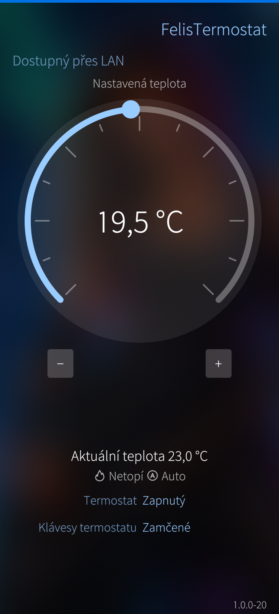
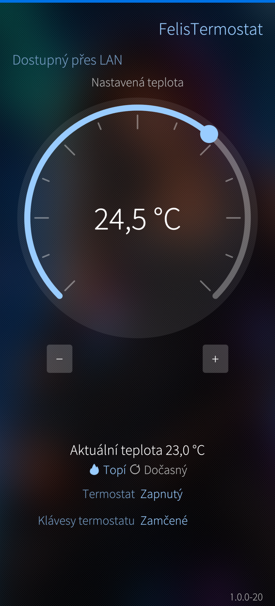

# FelisTermostat


FelisTermostat is a native Sailfish OS app for controlling a compatible Tuya thermostat directly over your local network. It was tested with the **EMOS GoSmart P56211** on a **Jolla Phone 2026 running Sailfish OS 5.2**.

## Features

- View the measured room temperature, setpoint, heating activity, operating mode, thermostat power, physical keypad lock and connection status.
- Set the temperature between 5.0 and 35.0 °C in 0.5 °C steps. Hold the dial handle briefly before dragging, or tap **−** or **+**.
- Use the native Sailfish Silica pull-down menu to select a mode, toggle thermostat power or lock and unlock the physical keypad.
- See when a change is awaiting confirmation. The app checks the thermostat after sending a command and shows an error if the change cannot be confirmed.
- Check both temperatures and heating activity on the Sailfish home-screen cover. The app includes English and Czech.

### Screenshots

 

Captured on a Jolla Phone 2026 with Czech selected (build 1.0.0-20).

## Compatibility and networking

| | Tested configuration |
| --- | --- |
| Thermostat | EMOS GoSmart P56211 |
| Phone and OS | Jolla Phone 2026, Sailfish OS 5.2 |
| LAN protocol | Tuya LAN 3.4 over IPv4, TCP port 6668 |
| RPM architecture | aarch64 |

Other Tuya thermostats are unverified. Their protocol version or data points may differ. The phone needs a route to the thermostat's LAN address. A VPN can provide this route when its routing and firewall rules permit TCP port 6668 from the phone to the thermostat. Prefer a private VPN for remote use and keep the thermostat's port off the public internet.

## Installation

Download `harbour-felistermostat-1.0.0-24.aarch64.rpm` from the [v1.0.0 release](https://github.com/MiPal666/FelisTermostat/releases/tag/v1.0.0) and copy it to your Jolla's home directory. From the phone terminal, check the dependencies and install the package.

```bash
rpm -q python3-base python3-libs pyotherside-qml-plugin-python3-qt5 sailfishsilica-qt5
devel-su rpm -Uvh --test "$HOME/harbour-felistermostat-1.0.0-24.aarch64.rpm"
devel-su rpm -Uvh "$HOME/harbour-felistermostat-1.0.0-24.aarch64.rpm"
```

The RPM uses Sailfish OS's Python 3.11 runtime and keeps its Python packages in an app-private directory. The `rpm` command checks dependencies and reports missing packages for you to install through the phone's package manager.

## Setup

1. Find the thermostat's **LAN IPv4 address** in your router's DHCP client list. A DHCP reservation keeps the address stable.
2. Obtain the **Device ID** and **Local Key** for your thermostat. If you already have both, skip the cloud setup. Otherwise, pair the thermostat with a compatible Tuya app such as Smart Life, link that account to a Tuya Developer Platform cloud project in the matching region, and look up the device in the project. With valid API access, **Query Device Details** returns the device ID and `local_key`. You can also use the TinyTuya wizard during this setup. Tuya controls the availability, terms and duration of API access. [Tuya API documentation](https://developer.tuya.com/en/docs/cloud/3829469013?id=Kcp2l2v9wma0m) · [TinyTuya wizard instructions](https://github.com/jasonacox/tinytuya#setup-wizard)
3. Open **Settings** from FelisTermostat's top pull-down menu and enter the IPv4 address, Device ID and 16-character ASCII Local Key.
4. In the Settings pull-down menu choose **Test connection** to check the entered values, then **Save**. The test result is shown on the page and clears when a field changes. When updating an existing configuration, leave the key field empty to keep the saved key.

Normal operation uses the saved local credentials and requires no active Tuya Cloud API subscription. Resetting or re-pairing the thermostat can change its local key. Treat the key, Device ID and diagnostic exports as private.

For manual provisioning, see the [example JSON](docs/thermostat.example.json). Replace all placeholders and save your private copy as `${XDG_CONFIG_HOME:-$HOME/.config}/cz.feliscatus/felistermostat/thermostat.json` on the phone with mode `0600`. The app loads that file on startup.

If you already have a private TinyTuya snapshot, the read-only diagnostic tool can extract one matching device into a new private file. Replace the example address before running the command.

```bash
python3 -B tools/probe_thermostat.py --prepare-config snapshot.json --ip 192.0.2.44 --config thermostat.local.json
```

## Operating modes

| Mode | Behavior |
| --- | --- |
| Auto | Follows the weekly schedule stored in the thermostat. |
| Temporary | Holds an override until the next scheduled event. Changing the setpoint in Auto can cause the firmware to enter this mode automatically. |
| Manual | Holds the manually selected setpoint outside the weekly schedule until changed. |
| Boost and Holiday | Selects the corresponding firmware mode. The thermostat determines how the mode works. |

The app displays the state reported by the device. The weekly schedule, holiday and boost parameters are managed by the thermostat. Turning the thermostat off may leave its firmware's frost protection active. See the [verified data point map](docs/emos-p56211-data-points.md) for protocol details.

## Manual aarch64 build

The front end uses Qt 5, QML and Sailfish Silica, with a C++ launcher and a Python 3.11 backend reached through PyOtherSide. TinyTuya implements the local protocol. The [dependency notices](THIRD_PARTY.md) list the Python packages included in the RPM.

Use a working Sailfish SDK and an aarch64 build target. The default target in the script is `SailfishOS-5.1.0.11-aarch64.default`, used to build the RPM tested on Sailfish OS 5.2. Run `sfdk tools list` to see your installed targets. Pass your aarch64 target name as the second argument to the build script if it differs.

From the project root, prepare an isolated wheel archive and run the build manually. The wheels target the phone's CPython 3.11 ABI and aarch64 glibc. Pinning the versions matches the package set in the tested RPM.

```bash
felis_build_dir=$(mktemp -d)
python3 -m venv "$felis_build_dir/venv"
"$felis_build_dir/venv/bin/python" -m pip --isolated install --requirement requirements-rpm.txt --no-deps --target "$felis_build_dir/site" --platform manylinux2014_aarch64 --platform manylinux_2_17_aarch64 --implementation cp --python-version 3.11 --abi cp311 --only-binary=:all: --no-compile
tar --exclude='site/bin' -C "$felis_build_dir" -czf "$felis_build_dir/vendor-site.tar.gz" site
bash tools/build-rpm.sh "$felis_build_dir/vendor-site.tar.gz"
```

The build script copies an allowlist of sources into a dedicated build directory and puts the resulting RPM in `RPMS/`. The archive passed to it must contain only the wheel files and metadata under `site/`. For a build with the same dependency payload as the tested RPM, reuse the archive that was used to build it.

### Tests and translations

Run the simulated thermostat tests from the project root. They use the Python standard library and do not contact a real device.

```bash
PYTHONPATH=python python3 -B -m unittest discover -s tests -v
```

English is the default. Qt selects the included Czech catalog for a supported system locale. To add German, for example, create a source catalog, translate it with Qt Linguist and keep placeholders such as `%1`.

```bash
lupdate qml -extensions qml -locations none -source-language en -target-language de_DE -ts translations/harbour-felistermostat-de.ts
```

The RPM build compiles matching `translations/harbour-felistermostat-*.ts` catalogs with `lrelease`.

## Known limitations

- The app controls one configured thermostat using a known IPv4 address.
- Weekly schedules and firmware-specific parameters are configured on the thermostat or in its companion app.
- The home-screen cover refreshes while visible. Its regular refresh interval is 30 seconds, compared with 8 seconds in the foreground.
- A successful connection test verifies a status read using the entered credentials.

## License and credits

Copyright © 2026 Michal Kasík (MiPal). Created with help from Klára (AI). Thanks to the TinyTuya, Qt, PyOtherSide and Sailfish OS contributors.

FelisTermostat, including its project icon, is free software under the [GNU General Public License, version 3 or any later version](LICENSE) (`GPL-3.0-or-later`). You may use, study and modify it. When distributing a covered version, follow the GPL's terms, including its corresponding source requirements. The software is provided without warranty. Bundled third-party components retain their own terms.
